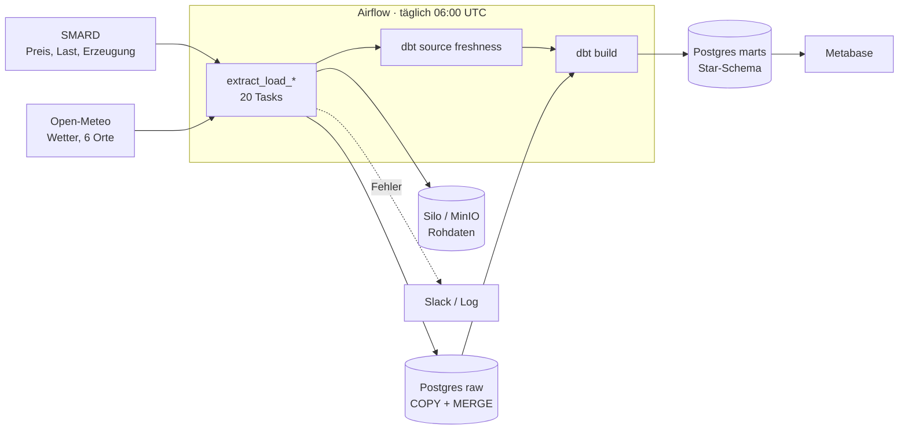
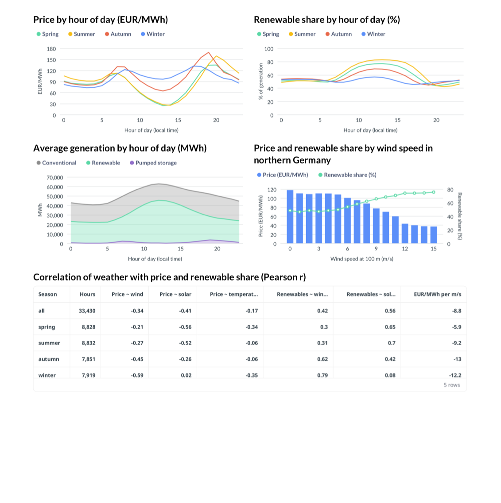
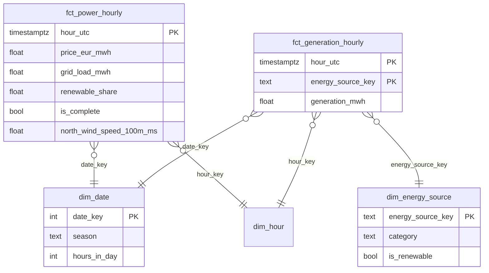

# German Power Market Pipeline

[](https://github.com/riodeb21195/german-power-market-pipeline/actions/workflows/ci.yml)
[](https://github.com/riodeb21195/german-power-market-pipeline/actions/workflows/cd.yml)

**Leitfrage:** Wann ist Strom in Deutschland am billigsten und am grünsten, und welche Rolle spielt das Wetter?

Eine tägliche Batch-Pipeline lädt Strommarktdaten der Bundesnetzagentur (SMARD) und Wetterdaten
(Open-Meteo), legt die Rohdaten unverändert ab, lädt sie idempotent in Postgres, modelliert sie mit
dbt in ein Star-Schema und zeigt das Ergebnis in Metabase.



### Kennzahlen

Gemessen am 26.10.2026 auf einem Intel-MacBook (2019, 8 GB RAM), Start mit leeren Volumes.

| | |
|---|---|
| `make up` bis fertig geladene Daten | ca. 12 Minuten; der erste DAG-Lauf (Daten ab 01.01.2023 + dbt) dauerte **589 s** |
| Daten | 647.441 Zeilen aus 20 Quellen: 446.561 Strommarkt-, 200.880 Wetterzeilen, 33.431 vollständige Stunden |
| Datenqualität | 20/20 Zeilenabgleiche stimmen, 0 Duplikate, 77/77 dbt-Knoten (Modelle und Tests) grün |
| Robustheit | beim Laden über die Kommandozeile brach eine SMARD-Verbindung ab (`RemoteProtocolError`), der Retry hat es abgefangen |
| Tests | 105 pytest-Tests (Unit + Testcontainers), 99 % Coverage |
| Speicher | ca. 2,7 GB mit allen Diensten inkl. Metabase |

### Ergebnis

Vollständige Stunden vom 01.01.2023 bis 24.10.2026, deutsche Uhrzeit. „Grün“ = Anteil erneuerbarer
Energien an der Erzeugung.

| Jahreszeit | Billigste Stunde | Ø Preis | Teuerste Stunde | Ø Preis | Grünste Stunde | Ø EE-Anteil |
|---|---|---|---|---|---|---|
| Frühling | 13 Uhr | 24,5 €/MWh | 20 Uhr | 134,5 €/MWh | 13 Uhr | 76,7 % |
| Sommer | 14 Uhr | 25,6 €/MWh | 20 Uhr | 158,9 €/MWh | 13 Uhr | 82,5 % |
| Herbst | 13 Uhr | 64,6 €/MWh | 19 Uhr | 168,8 €/MWh | 12 Uhr | 68,9 % |
| Winter | 3 Uhr | 73,2 €/MWh | 17 Uhr | 131,9 €/MWh | 12 Uhr | 56,7 % |

- Von Frühling bis Herbst fallen billig und grün mittags zusammen (Solarstrom): In 20 von 21
  Kombinationen aus Jahreszeit und Wochentag liegen die billigste und die grünste Stunde höchstens
  eine Stunde auseinander.
- Im Winter nicht: Billig ist es nachts (wenig Verbrauch), grün weiterhin mittags. Dazwischen
  liegen 8 bis 9 Stunden.
- Wind ist im Winter der stärkste Faktor (Korrelation Preis ~ Wind −0,59, etwa −12 €/MWh pro m/s),
  im Frühling und Sommer die Sonneneinstrahlung (−0,56 / −0,52). Bei unter 3 m/s Wind in
  Norddeutschland lag der Preis im Schnitt bei 109–118 €/MWh, ab 13 m/s bei 37–40 €/MWh.



### Quickstart

Voraussetzungen: Docker (≥ 6 GB RAM für Docker), [uv](https://docs.astral.sh/uv/), make.

```bash
git clone https://github.com/riodeb21195/german-power-market-pipeline.git
cd german-power-market-pipeline
make install
cp .env.example .env    # alle change-me ersetzen, der Befehl für den Fernet-Key steht in der Datei
make up                 # Postgres, Silo, Airflow; der DAG startet sofort
make up PROFILES=bi     # zusätzlich Metabase auf http://localhost:3000
```

Airflow: http://localhost:8080, Benutzer `admin`, Passwort `AIRFLOW_ADMIN_PASSWORD` aus `.env`.

---

## Ablauf

1. **Extract** – SMARD liefert Wochenpakete, Open-Meteo einen Zeitraum je Ort. Timeout, Retry mit
   exponentiellem Backoff nur bei 429/5xx/Timeout, Rate Limit. Jede Antwort wird vor dem Speichern
   gegen ein Pydantic-Modell geprüft (`extra="forbid"`, erwartete Einheiten, UTC). `null` bei
   SMARD heißt „noch nicht veröffentlicht“ und wird nicht gespeichert.
2. **Watermark** – `meta.checkpoints` merkt sich pro Quelle die letzte geladene Stunde. Geladen wird
   ab Watermark minus 7 Tage, weil SMARD nachträglich korrigiert.
3. **Rohdaten** – unverändert nach Silo (S3-API), z. B. `smard/4169_DE-LU/date=2026-10-19/<hash>.json`.
   Gleicher Inhalt ergibt den gleichen Schlüssel, also kein Duplikat.
4. **Laden** – `COPY` in eine Temp-Tabelle, Deduplizierung, `MERGE` in `raw.*`. Aktualisiert wird
   nur, wenn sich Werte wirklich ändern.
5. **Abgleich** – Quellstunden gegen Zielzeilen je Reihe in `meta.reconciliation`, jeder Lauf in
   `meta.pipeline_runs`.
6. **dbt** – staging → intermediate → marts, Tests, Freshness, dev- und prod-Ziel.
7. **Airflow** – eine gemappte Task je Quelle, danach Freshness und `dbt build`. Nachladen:
   `make backfill START=2025-01-01 END=2025-01-31` oder `airflow backfill create …`.

### Datenmodell



- Gespeichert wird in UTC, ausgewertet in deutscher Zeit. Tage der Zeitumstellung haben 23 oder
  25 Stunden, ein dbt-Test prüft das.
- Eine Stunde zählt nur, wenn Preis, Last und alle Pflicht-Energieträger vorliegen (`is_complete`).
- Analyse-Tabellen: `mart_hourly_profile` (billigste und grünste Stunde je Jahreszeit, Wochentag,
  Uhrzeit) und `mart_weather_correlation`.
- Data Dictionary: `make dbt-docs` → http://localhost:8081

### What happens when …

| Fall | Verhalten | Belegt durch |
|---|---|---|
| die Quelle mit 5xx antwortet oder hängt | Retry mit Backoff, danach Lauf `failed`, nichts gespeichert, Slack- bzw. Log-Alarm | `tests/unit/test_http.py`, `tests/integration/test_pipeline.py` |
| sich das Format ändert | `SchemaDriftError … unexpected field 'unit'`, kein Retry, nichts gespeichert, andere Quellen laufen weiter | `tests/unit/test_schemas.py`, `tests/integration/test_pipeline.py` |
| ein Lauf doppelt ausgeführt wird | 0 eingefügt, 0 aktualisiert, keine neue Rohdatei | `tests/integration/test_pipeline.py`, `test_warehouse.py` |
| SMARD alte Werte korrigiert | der 7-Tage-Rückblick liest sie erneut, nur geänderte Zeilen werden aktualisiert | `tests/integration/test_pipeline.py` |
| ein Lauf zu lange dauert | `dagrun_timeout` (2 h) lässt ihn fehlschlagen, das löst den DAG-Alarm aus | `airflow/tests/check_dags.py` |
| keine neuen Daten kommen | `dbt source freshness` warnt nach 30 h, bricht nach 54 h ab | `dbt/models/staging/_sources.yml` |

Hilfe bei Fehlern: [docs/runbook.md](docs/runbook.md). Entscheidungen: [docs/decisions/](docs/decisions/).

### Bewusst weggelassen

- **SCD Typ 2:** Die Einstufung der Energieträger ändert sich praktisch nie, ein Snapshot wäre nur Demonstration.
- **Deadline Alerts (Airflow 3):** noch experimentell; `dagrun_timeout` mit Fehler-Alarm reicht.
- **Dashboard als Code:** Metabase ist von Hand eingerichtet, die SQL der Fragen liegt in `metabase/questions/`.
- **Eigene Rollen und Rechte, Secrets-Manager:** für einen lokalen Stack übertrieben.
- **Celery, Redis, weitere Worker:** ein DAG braucht keinen verteilten Executor.
- **Hosting der dbt-Doku:** `make dbt-docs` lokal genügt.

### Grenzen

- Sechs Wetterpunkte, ungewichtet gemittelt: eine Annäherung, kein flächendeckendes Wetterbild.
- Korrelation ist keine Ursache. Jahreszeit, Verbrauch und Brennstoffpreise wirken gleichzeitig.
- „Grün“ bezieht sich auf die Erzeugung, nicht auf den Verbrauch und nicht auf CO₂; Im- und Exporte fehlen.
- Nur der Day-Ahead-Preis der Zone DE-LU.
- Die SMARD-Schnittstelle ist öffentlich, aber nicht offiziell dokumentiert.

### Dashboard einrichten

Nach `make up PROFILES=bi` auf http://localhost:3000 ein Konto anlegen und die Datenbank
hinzufügen: Postgres, Host `postgres`, Port `5432`, Datenbank und Benutzer aus `.env`, Schema
`analytics_marts`. Dann für jede Datei in `metabase/questions/` eine SQL-Frage anlegen.

### Befehle

| | |
|---|---|
| `make up` / `make down` | Stack starten / stoppen |
| `make test` / `make lint` / `make format` | Tests / Prüfung / Formatierung |
| `make run` / `make backfill START=… END=…` | Lauf bzw. Zeitraum über die Kommandozeile |
| `make dbt-build` / `make dbt-docs` | dbt bauen / Data Dictionary |
| `make dag-check` | Airflow-Image bauen und DAG prüfen |

### Projektstruktur

```
airflow/            Dockerfile, DAG, DAG-Prüfung
dbt/                staging, intermediate, marts, seeds, tests
docker/postgres/    Datenbanken beim ersten Start
metabase/questions/ SQL der Dashboard-Fragen
src/power_market/   Extract, Load, Pipeline, CLI, Alerting
tests/              Unit, Integration, aufgezeichnete API-Antworten
docs/               Entscheidungen, Runbook, Screenshot
```

### Quellen und Lizenzen

- Strommarktdaten: **Bundesnetzagentur | SMARD.de**, CC BY 4.0 ([Datennutzung](https://www.smard.de/en/datennutzung))
- Wetterdaten: **Open-Meteo.com**, CC BY 4.0
