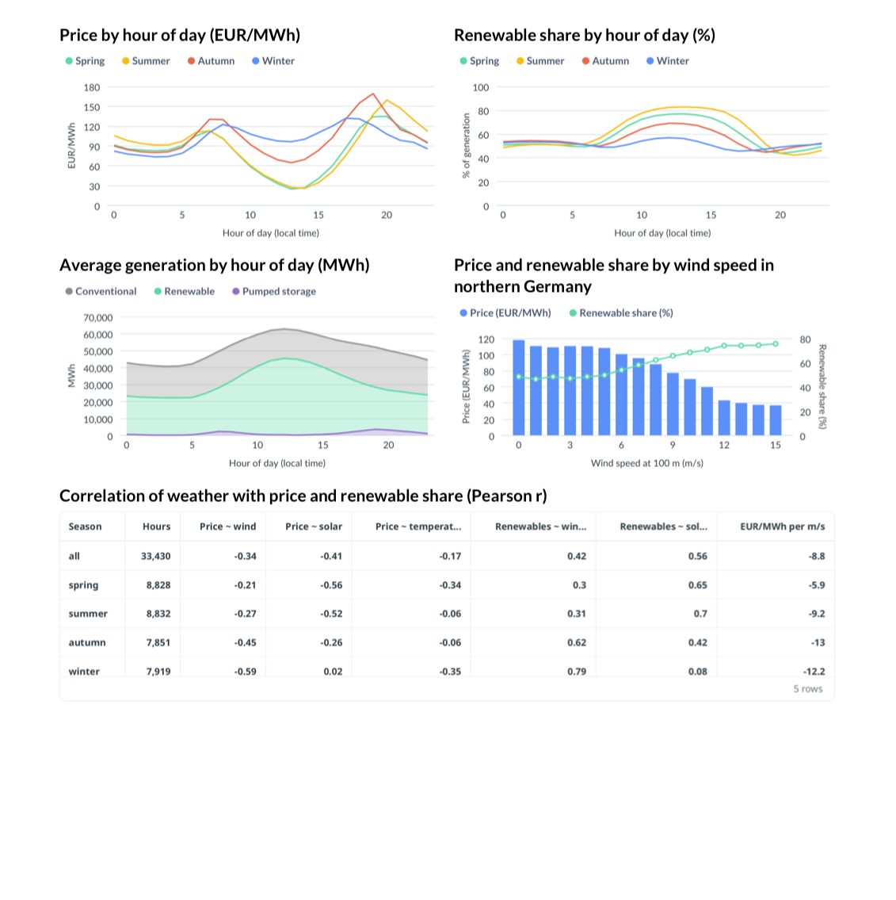
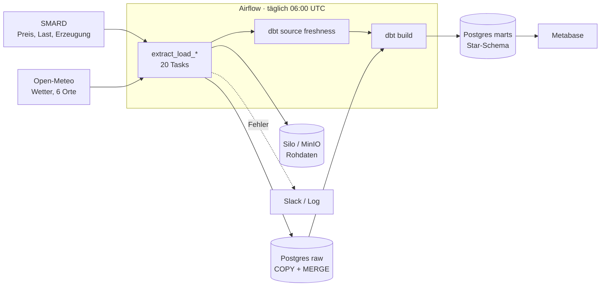

# German Power Market Pipeline

[](https://github.com/riodeb21195/german-power-market-pipeline/actions/workflows/ci.yml)
[](https://github.com/riodeb21195/german-power-market-pipeline/actions/workflows/cd.yml)

**Leitfrage:** Wann ist Strom in Deutschland am billigsten und am grünsten, und welche Rolle spielt das Wetter?

Eine tägliche Batch-Pipeline lädt Strommarktdaten der Bundesnetzagentur (SMARD) und Wetterdaten
(Open-Meteo), modelliert sie mit dbt in ein Star-Schema und zeigt das Ergebnis in Metabase.



## Ergebnis

Vollständige Stunden vom 01.01.2023 bis 24.10.2026, deutsche Uhrzeit. „Grün“ = Anteil erneuerbarer Energien an der Erzeugung.

| Jahreszeit | Billigste Stunde | Ø Preis | Teuerste Stunde | Ø Preis | Grünste Stunde | Ø EE-Anteil |
|---|---|---|---|---|---|---|
| Frühling | 13 Uhr | 24,5 €/MWh | 20 Uhr | 134,5 €/MWh | 13 Uhr | 76,7 % |
| Sommer | 14 Uhr | 25,6 €/MWh | 20 Uhr | 158,9 €/MWh | 13 Uhr | 82,5 % |
| Herbst | 13 Uhr | 64,6 €/MWh | 19 Uhr | 168,8 €/MWh | 12 Uhr | 68,9 % |
| Winter | 3 Uhr | 73,2 €/MWh | 17 Uhr | 131,9 €/MWh | 12 Uhr | 56,7 % |

- Frühling bis Herbst: billig und grün fallen mittags zusammen (Solar). In 20 von 21 Kombinationen aus Jahreszeit und Wochentag liegen sie höchstens eine Stunde auseinander.
- Winter: billig nachts (wenig Verbrauch), grün mittags, 8 bis 9 Stunden Abstand.
- Wind ist im Winter der stärkste Faktor (Korrelation −0,59, etwa −12 €/MWh pro m/s): unter 3 m/s im Norden 109–118 €/MWh, ab 13 m/s 37–40 €/MWh. Im Frühling und Sommer dominiert die Sonneneinstrahlung (−0,56 / −0,52).

## Architektur



Jede API-Antwort wird gegen ein Pydantic-Modell geprüft und unverändert in einem S3-kompatiblen Speicher abgelegt. Geladen wird inkrementell ab Watermark minus 7 Tage, weil SMARD nachträglich korrigiert. dbt baut staging → intermediate → marts. Details: [docs/architecture.md](docs/architecture.md).

## Tech-Stack

Python 3.12 (httpx, Pydantic, psycopg) · Postgres · dbt · Airflow 3 · Silo/MinIO (S3) · Metabase · Docker Compose · GitHub Actions · pytest + Testcontainers · ruff, mypy (strict), sqlfluff

## Highlights

- **Datenqualität:** 647.441 Zeilen aus 20 Quellen, 20/20 Zeilenabgleiche Quelle ↔ Ziel stimmen, 0 Duplikate, 77/77 dbt-Modelle und -Tests grün.
- **Idempotent:** `COPY` + `MERGE`, inhaltsadressierte Rohdateien. Ein doppelter Lauf fügt 0 Zeilen ein und ändert 0.
- **Fehlerbehandlung:** Retry mit Backoff nur bei 429/5xx/Timeout. Schema-Drift bricht ohne Retry ab, andere Quellen laufen weiter. Freshness-Checks und Slack- bzw. Log-Alarm. Alle Szenarien: [docs/design-decisions.md](docs/design-decisions.md).
- **Tests und CI/CD:** 105 pytest-Tests (Unit + Testcontainers), 99 % Coverage. CI mit Lint, dbt-Build auf echten Beispieldaten und DAG-Check; CD veröffentlicht das Airflow-Image nach GHCR.
- **Bewusste Trade-offs:** z. B. kein SCD Typ 2 und kein Celery-Executor, mit Begründung in [ADRs](docs/decisions/).

## Quickstart

Voraussetzungen: Docker, [uv](https://docs.astral.sh/uv/), make.

```bash
make install
cp .env.example .env    # change-me ersetzen, Fernet-Key-Befehl steht in der Datei
make up                 # Postgres, Silo, Airflow (http://localhost:8080); der DAG startet sofort
make up PROFILES=bi     # zusätzlich Metabase auf http://localhost:3000
```

## Weiterführende Doku

- [Architektur und Datenmodell](docs/architecture.md)
- [Fehlerszenarien, Weggelassenes, Grenzen](docs/design-decisions.md)
- [Setup, Befehle, Projektstruktur](docs/setup.md)
- [Runbook](docs/runbook.md) · [Architecture Decision Records](docs/decisions/)

## Quellen und Lizenzen

- Strommarktdaten: **Bundesnetzagentur | SMARD.de**, CC BY 4.0 ([Datennutzung](https://www.smard.de/en/datennutzung))
- Wetterdaten: **Open-Meteo.com**, CC BY 4.0
