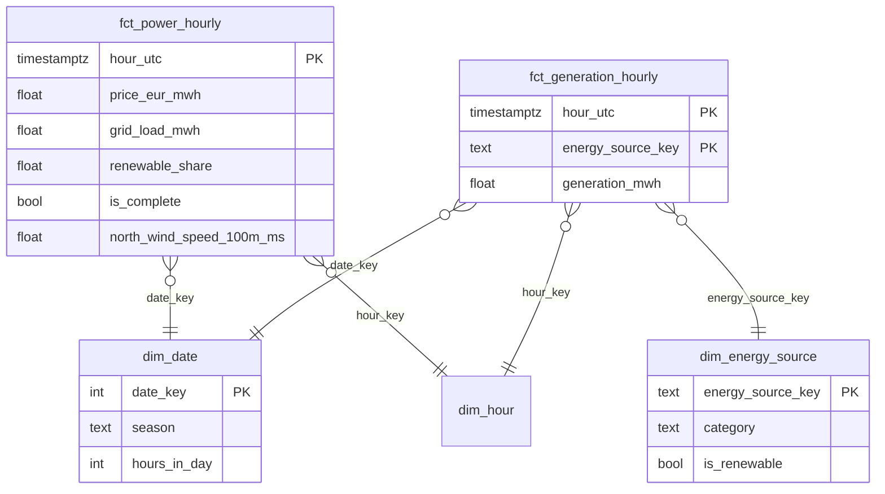

# Architektur

Überblick: [README](../README.md#architektur). Entscheidungen im Detail: [decisions/](decisions/).

## Ablauf

1. **Extract** – SMARD liefert Wochenpakete, Open-Meteo einen Zeitraum je Ort. Timeout, Retry mit
   exponentiellem Backoff nur bei 429/5xx/Timeout, Rate Limit. Jede Antwort wird vor dem Speichern
   gegen ein Pydantic-Modell geprüft (`extra="forbid"`, erwartete Einheiten, UTC). `null` bei
   SMARD heißt „noch nicht veröffentlicht“ und wird nicht gespeichert.
2. **Watermark** – `meta.checkpoints` merkt sich pro Quelle die letzte geladene Stunde. Geladen wird
   ab Watermark minus 7 Tage, weil SMARD nachträglich korrigiert.
3. **Rohdaten** – unverändert nach Silo (S3-API), z. B. `smard/4169_DE-LU/date=2026-10-19/<hash>.json`.
   Gleicher Inhalt ergibt den gleichen Schlüssel, also kein Duplikat.
4. **Laden** – `COPY` in eine Temp-Tabelle, Deduplizierung, `MERGE` in `raw.*`. Aktualisiert wird
   nur, wenn sich Werte wirklich ändern.
5. **Abgleich** – Quellstunden gegen Zielzeilen je Reihe in `meta.reconciliation`, jeder Lauf in
   `meta.pipeline_runs`.
6. **dbt** – staging → intermediate → marts, Tests, Freshness, dev- und prod-Ziel.
7. **Airflow** – eine gemappte Task je Quelle, danach Freshness und `dbt build`. Nachladen:
   `make backfill START=2025-01-01 END=2025-01-31` oder `airflow backfill create …`.

## Datenmodell

- Gespeichert wird in UTC, ausgewertet in deutscher Zeit. Tage der Zeitumstellung haben 23 oder
  25 Stunden, ein dbt-Test prüft das.
- Eine Stunde zählt nur, wenn Preis, Last und alle Pflicht-Energieträger vorliegen (`is_complete`).
- Analyse-Tabellen: `mart_hourly_profile` (billigste und grünste Stunde je Jahreszeit, Wochentag,
  Uhrzeit) und `mart_weather_correlation`.
- Data Dictionary: `make dbt-docs` → http://localhost:8081
